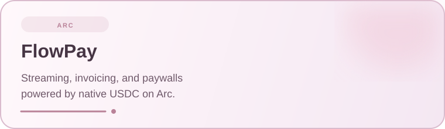
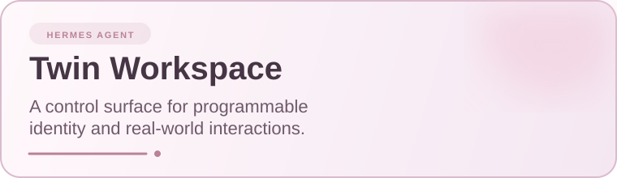
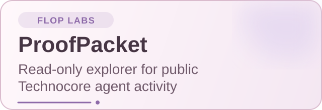
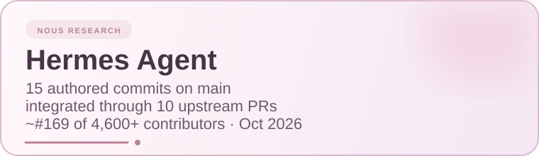
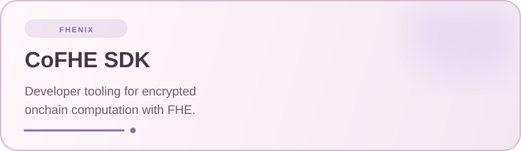
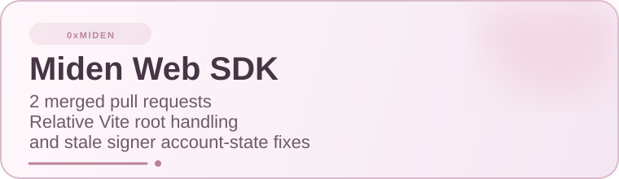
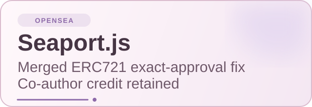
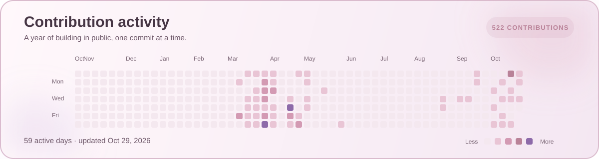

  

  <strong>AI agents · privacy tooling · onchain infrastructure</strong>

  
  

## Selected builds

<table>
  <tr>
    <td width="50%"></td>
    <td width="50%"></td>
  </tr>
  <tr>
    <td width="50%"></td>
    <td width="50%"></td>
  </tr>
</table>

## Open source contributions

<table>
  <tr>
    <td width="50%"></td>
    <td width="50%"></td>
  </tr>
  <tr>
    <td width="50%"></td>
    <td width="50%"></td>
  </tr>
</table>

## Toolkit

  
  
  
  
  
  
  
  

  

